# Notre Musée — galerie 3D interactive pour un couple

Un musée virtuel en 3D qui tourne dans le navigateur, sur ordinateur comme sur téléphone. Les photos d'un couple y sont exposées comme des œuvres d'art. Deux avatars (lui et elle) s'y promènent, s'assoient sur les bancs devant les photos et dansent ensemble.

Tout le contenu (titre, prénoms, salles, photos, couleurs des avatars, musique) se règle dans **un seul fichier : `config.json`**.

| Accueil | Enfilade des salles | Cloison centrale |
| --- | --- | --- |
| 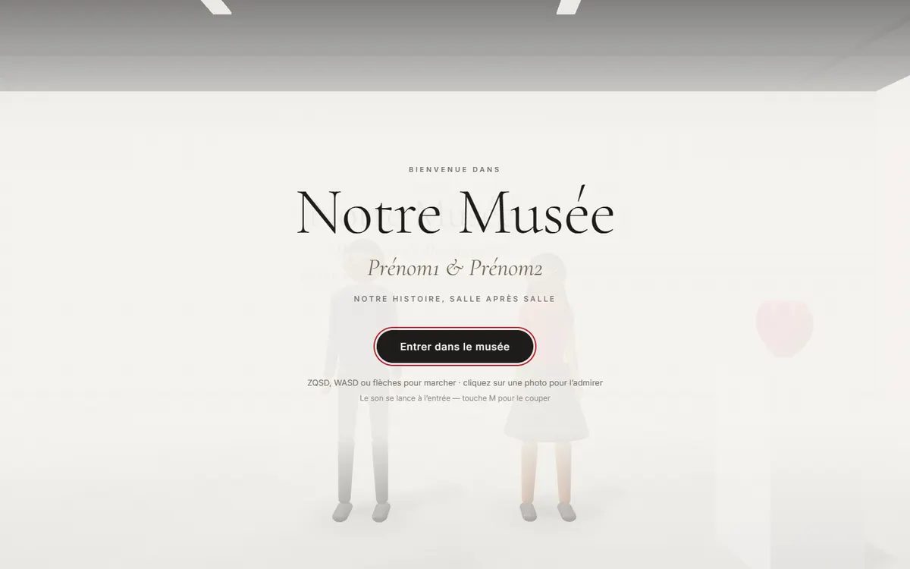 | 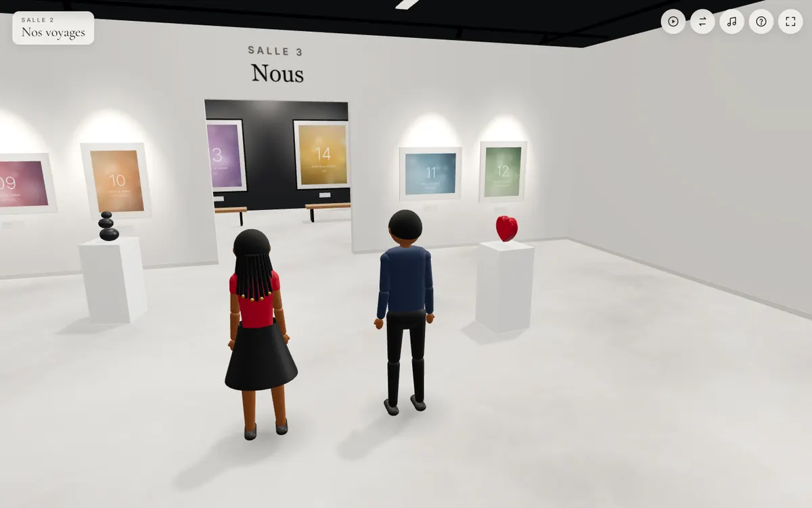 | 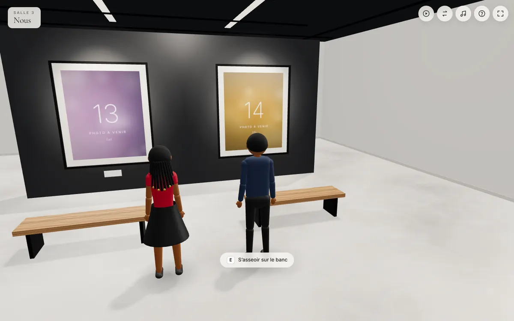 |

| Photo en grand | Danse | Visite guidée |
| --- | --- | --- |
| 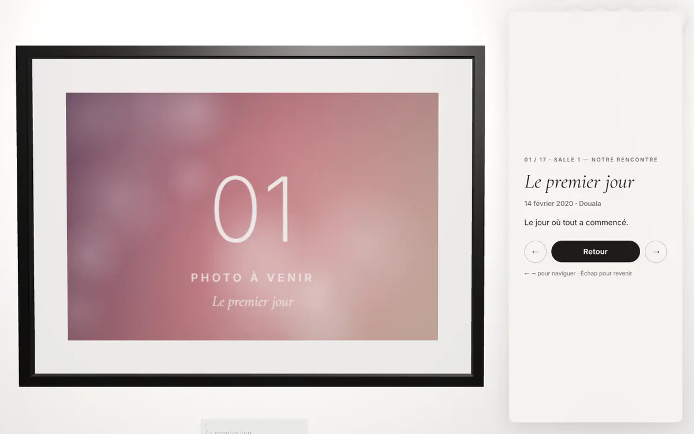 | 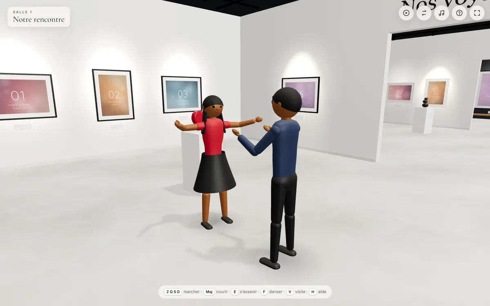 | 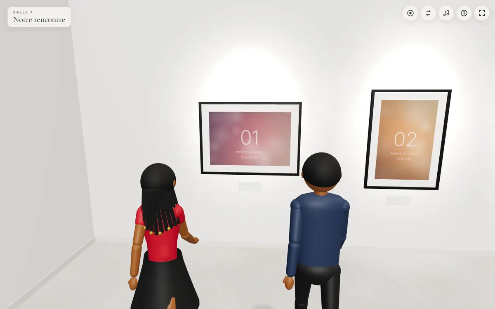 |

| Téléphone | Assis sur le banc | Photo (téléphone) | Vidéo 9:16 |
| --- | --- | --- | --- |
| 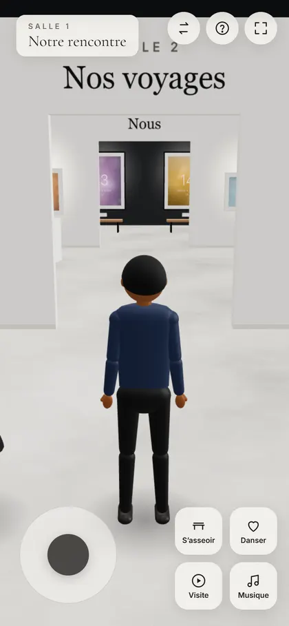 | 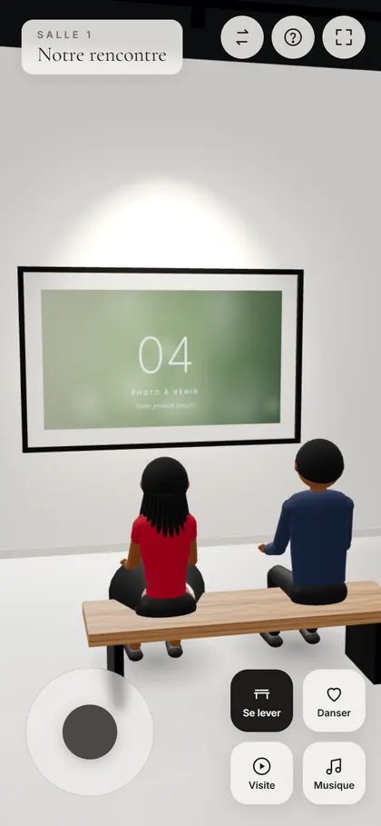 | 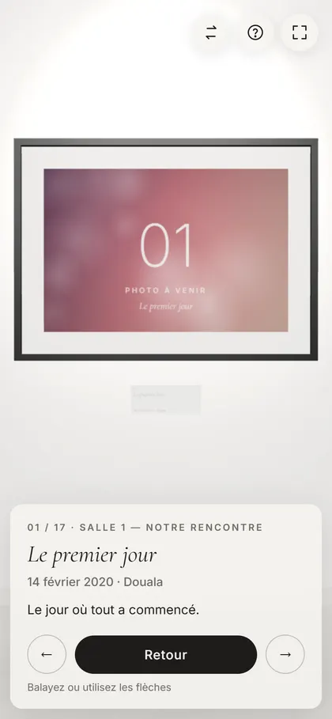 | 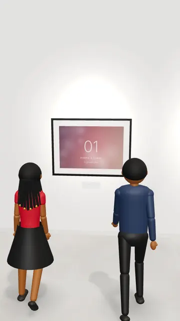 |

> Les captures montrent les **images de remplacement** (dégradés numérotés) affichées tant que vos photos ne sont pas ajoutées.

---

## Sommaire

1. [Démarrage rapide](#1-démarrage-rapide)
2. [Ajouter vos photos](#2-ajouter-vos-photos)
3. [Remplir config.json](#3-remplir-configjson)
4. [Commandes](#4-commandes)
5. [Visite guidée et vidéos 9:16](#5-visite-guidée-et-vidéos-916)
6. [Avatars 3D (modèles .glb facultatifs)](#6-avatars-3d-modèles-glb-facultatifs)
7. [Construire et déployer](#7-construire-et-déployer)
8. [Performances](#8-performances)
9. [Tests](#9-tests)
10. [Organisation du code](#10-organisation-du-code)
11. [Dépannage](#11-dépannage)
12. [Améliorations possibles](#12-améliorations-possibles)

---

## 1. Démarrage rapide

Prérequis : [Node.js](https://nodejs.org) **22 ou plus récent**.

```bash
npm install
```

```bash
npm run dev
```

Ouvrez l'adresse affichée (par défaut http://localhost:5173). Sur un téléphone du même réseau Wi-Fi, utilisez l'adresse « Network » affichée par la commande.

Pendant `npm run dev`, toute modification de `config.json` ou de `public/photos/` recharge la page automatiquement.

## 2. Ajouter vos photos et vidéos

**Un dossier par salle** : déposez simplement vos fichiers dans le dossier de la salle, il n'y a rien à déclarer.

```
public/photos/rencontre/   → salle « Notre rencontre »
public/photos/voyages/     → salle « Nos voyages »
public/photos/nous/        → salle « Nous » (avec la cloison centrale)
```

- Le nom du dossier correspond à l'`id` de la salle (ou à son nom : `Notre rencontre/` fonctionne aussi). Le dossier d'une nouvelle salle ajoutée dans `config.json` est créé par `npm run photos`.
- Un fichier posé directement dans `public/photos/`, hors dossier, est placé dans la salle dont la période est la plus proche de sa date.
- **Photos** : JPG, PNG, WebP, AVIF, et HEIC/HEIF (converti automatiquement en JPEG, voir plus bas).
- **Vidéos** : MP4 (conseillé, codec H.264), WebM, MOV. Elles jouent en boucle, sans le son, dans leur cadre (uniquement dans la salle où l'on se trouve, pour ménager la batterie). Cliquées, elles passent en grand **avec le son**, un bouton permet de le couper, et la musique de fond se baisse pendant ce temps.

**Titre et date sans rien écrire** : ils sont tirés du nom du fichier, par exemple `2020-02-14 Le premier jour.jpg` donne la date « 14 février 2020 » et le titre « Le premier jour ». Une numérotation comme `03 - Plage.mp4` est ignorée dans le titre mais sert à l'ordre. Les noms automatiques des téléphones (`IMG_20210403_…`, `WhatsApp Image…`, `RUID…`) ne donnent pas de titre : la photo s'appelle alors « Souvenir du 3 avril 2021 » (date de prise de vue EXIF ou date du nom). Pour un vrai titre, un lieu, une légende ou un grand format, déclarez le fichier dans `config.json` (section 3).

Puis lancez :

```bash
npm run photos
```

Ce script (sharp) :
- convertit les photos **HEIC/HEIF** (iPhone, Samsung…) en JPEG à côté de l'original, avec leur date de prise de vue. Sous Windows, il utilise le décodeur intégré (extension « Extensions d'image HEIF » du Microsoft Store, généralement déjà présente) ; sous macOS, l'outil `sips`. Les `.heic` d'origine peuvent ensuite être supprimés ;
- corrige l'orientation EXIF (photos de téléphone prises de côté) ;
- crée dans `public/photos/optimisees/` une version WebP 2048 px (ordinateur), une version 1024 px (téléphone) et une miniature 320 px (chargée en premier) ;
- signale les vidéos trop lourdes et les formats non lisibles sur le web (`.mov` HEVC d'iPhone, AVI…) ;
- ne modifie jamais vos originaux, ne refait que ce qui a changé (`--force` pour tout régénérer, `--qualite=85` pour changer la qualité) et supprime les variantes devenues inutiles.

Le site fonctionne aussi sans cette étape (il redimensionne alors les originaux dans le navigateur), mais il charge beaucoup plus vite avec.

À savoir :
- **Orientation** : le format (portrait, paysage, carré) est détecté à partir des dimensions réelles et de l'EXIF, et la taille du cadre s'y adapte. Pour une vidéo, le format est lu par le navigateur (rotation des vidéos de téléphone comprise).
- **Date** : `date` de `config.json`, sinon date de prise de vue EXIF, sinon date contenue dans le nom du fichier. Dans chaque salle, les photos sont triées par date ; celles sans date suivent, dans l'ordre des noms de fichiers.
- **Vidéos** : elles sont servies telles quelles (pas de conversion). Gardez-les courtes et légères : moins de 30 Mo conseillé, et GitHub refuse les fichiers de plus de 100 Mo. Pour compresser : [HandBrake](https://handbrake.fr), préréglage « Fast 1080p30 ». Les `.mov` HEVC d'iPhone ne sont pas lus par Chrome sur Android ou Windows : préférez MP4 (H.264), ou réglez l'iPhone sur « Le plus compatible ».
- **Images de remplacement** : tant qu'aucune vraie photo n'est présente, des images numérotées sont affichées. Dès que vous déposez des fichiers, les exemples de `config.json` sans fichier disparaissent tout seuls.
- **Après un ajout de photo**, relancez `npm run build` avant de redéployer : la liste des fichiers présents est calculée au build.

> ⚠️ **Vie privée** : le dépôt GitHub est **public**. Si vous ne voulez pas publier vos photos sur GitHub, décommentez la ligne `public/photos/` dans `.gitignore` et déployez par glisser-déposer du dossier `dist/` (Netlify). Le site déployé reste visible par toute personne qui a le lien.

## 3. Remplir config.json

Exemple complet : voir [`config.json`](config.json). Le fichier est **validé au démarrage**. En cas d'erreur, la page affiche la liste précise des problèmes (champ concerné et exemple de valeur correcte).

### Champs principaux

| Champ | Obligatoire | Description |
| --- | --- | --- |
| `titre` | oui | Titre du musée (écran d'accueil, mur d'entrée, onglet). |
| `prenoms.lui`, `prenoms.elle` | oui | Prénoms affichés à l'accueil et sur les murs. |
| `sousTitre` | non | Phrase sous le titre. |
| `urlSite` | non | Adresse publique du site, ex. `"https://notre-musee.vercel.app"`. Sert à l'aperçu des liens partagés (section 7). |
| `musique` | non | Fichier audio dans `public/`, ex. `"assets/music/musique.mp3"`. Sans fichier, une ambiance douce est **générée en direct** par le navigateur. |
| `theme` | non | `"clair"` (défaut) ou `"sombre"`. |
| `avatars` | non | Apparence de « lui » et « elle » (voir ci-dessous). |
| `salles` | oui | Liste des salles, dans l'ordre de visite. |
| `photos` | oui | Liste des photos (peut être vide). |

### Salles

| Champ | Description |
| --- | --- |
| `id` | Identifiant unique, sans espace (ex. `"voyages"`). |
| `nom` | Nom affiché au-dessus de l'entrée de la salle. |
| `cloisonCentrale` | `true` : la salle reçoit la grande cloison anthracite avec deux grands portraits (et deux autres possibles au dos). |
| `cadre` | Couleur des cadres de la salle : `"noir"` ou `"blanc"` (par défaut, alternance d'une salle à l'autre). |

La taille de chaque salle s'adapte automatiquement au nombre et au format de ses photos. Au-delà de 6 salles, la visite devient longue.

### Photos

| Champ | Description |
| --- | --- |
| `fichier` | Chemin dans `public/`, ex. `"photos/voyages/kribi.jpg"` (photo ou vidéo). |
| `salle` | `id` de la salle. **Facultatif** : par défaut, c'est le dossier du fichier qui décide ; hors dossier, la photo est placée dans la salle dont la période (dates des autres photos) est la plus proche. |
| `titre`, `lieu`, `legende` | Textes du cartel et du panneau d'information. |
| `date` | `2020-02-14`, `2020-02`, `2020` ou `14/02/2020`. Sert au tri chronologique. Affichée en français (« 14 février 2020 »). |
| `grandFormat` | `true` : grand cadre avec un banc devant. Dans la salle à cloison, les grands formats vont sur la cloison. |
| `cadre` | `"noir"` ou `"blanc"` pour ce cadre précis. |

Ordre de visite : salle par salle (ordre de la liste `salles`), puis chronologique dans chaque salle. Les photos sans date viennent en dernier. C'est l'ordre des flèches ← → et de la visite guidée.

**Cloison centrale** : on y accroche les grands formats de la salle. S'il y en a moins de deux, les premières photos en portrait de la salle sont automatiquement agrandies pour qu'il y ait toujours deux grands portraits.

### Avatars

```json
"avatars": {
  "lui":  { "peau": "#8d5524", "cheveux": "#1b1b1b", "haut": "#2b3a55", "bas": "#1f1f1f", "coiffure": "courte", "tenue": "pantalon" },
  "elle": { "peau": "#8d5524", "cheveux": "#1b1b1b", "haut": "#b3202a", "bas": "#1f1f1f", "coiffure": "tresses", "tenue": "jupe" }
}
```

| Champ | Valeurs |
| --- | --- |
| `peau`, `cheveux`, `haut`, `bas`, `chaussures` | Couleurs hexadécimales (`"#8d5524"`). |
| `coiffure` | `courte`, `rasee`, `afro`, `longue`, `chignon`, `tresses`. |
| `tenue` | `pantalon`, `jupe` (couleur `bas`), `robe` (couleur `haut`). |
| `taille` | Échelle de 0.7 à 1.3 (défaut : 1 pour lui, 0.95 pour elle). |
| `modele`, `animations` | Fichiers `.glb` facultatifs (section 6). |

## 4. Commandes

### Ordinateur

| Touche | Action |
| --- | --- |
| **Z Q S D** (AZERTY), **W A S D** (QWERTY) ou **flèches** | Marcher (par rapport à la caméra) |
| **Maj** | Courir |
| Glisser la souris · molette | Tourner autour de l'avatar · zoomer |
| **E** près d'un banc (moins de 1,5 m) | Les deux avatars s'assoient côte à côte face à la photo. Une touche de déplacement les relève. |
| **F** | Les avatars se font face et dansent ; la caméra tourne lentement autour d'eux. Une touche de déplacement arrête. |
| Clic sur une photo | La caméra glisse jusqu'à la photo et le panneau d'information s'affiche |
| **←** / **→** (mode photo) | Photo précédente / suivante |
| **Échap** | Retour (photo, banc, danse, visite, aide) |
| **Tab** | Changer d'avatar contrôlé (le compagnon suit l'autre) |
| **V** | Visite guidée (démarrer / arrêter) |
| **M** · **H** | Couper ou remettre la musique · aide |

### Téléphone et tablette

- **Joystick** en bas à gauche (poussé à fond, l'avatar court).
- Boutons **S'asseoir**, **Danser**, **Visite**, **Musique** en bas à droite. « S'asseoir » s'entoure de rouge près d'un banc.
- Glisser un doigt : tourner la caméra · pincer : zoomer · toucher une photo : l'admirer (balayer pour la suivante).
- En haut : changer d'avatar, aide, plein écran.

Le compagnon suit l'avatar contrôlé à environ 1,2 m sur le côté, marche ou court pour le rattraper, s'arrête quand il est à sa place et contourne les murs.

## 5. Visite guidée et vidéos 9:16

**Visite guidée** (touche V ou bouton) : le couple parcourt toutes les photos dans l'ordre de visite. Il s'arrête 4 secondes devant chacune, s'assoit devant les grands formats, puis danse à la fin dans la salle « Nous » (ou à défaut la salle à cloison, sinon la dernière). Une touche de déplacement l'interrompt.

**Vidéos Reels / TikTok / Status** : ajoutez `?format=9x16` à l'adresse :

```
http://localhost:5173/?format=9x16
https://votre-site.netlify.app/?format=9x16&pause=2
```

- Le rendu est vertical (9:16), centré, **sans aucune interface** ni curseur.
- Un clic lance la musique, le travelling d'introduction puis la visite guidée ; la danse finale continue indéfiniment pour terminer la vidéo.
- `pause=2` règle la durée de l'arrêt devant chaque photo (en secondes) pour une vidéo plus courte. Avec 17 photos : environ 3 min avec `pause=4`, environ 2 min 15 avec `pause=1`.
- Pour enregistrer : enregistreur d'écran du téléphone, ou sur ordinateur OBS Studio (« Capture de fenêtre » recadrée sur la zone verticale) ou la Xbox Game Bar (Windows + G). Pour une image nette, utilisez une fenêtre d'au moins 1080 px de haut, en plein écran (F11).

## 6. Avatars 3D (modèles .glb facultatifs)

**Par défaut, aucun téléchargement n'est nécessaire** : les avatars sont générés en code, en style « dessin animé 3D ». Ils ont un squelette, les animations Idle, Walk, Run, Sit et Dance, et les couleurs, coiffures et tenues de `config.json`. C'est aussi le **repli automatique** si un modèle `.glb` manque ou ne se charge pas : l'application ne plante jamais.

Pour un rendu plus détaillé, vous pouvez fournir vos propres modèles :

```json
"lui": { "modele": "assets/models/lui.glb", "animations": "assets/models/animations.glb", "peau": "#8d5524" }
```

Le chargeur :
- ramène le modèle à la bonne taille, pieds au sol ;
- retrouve les animations par leur nom (`idle`, `walk`, `run`/`jog`, `sit`, `sitting idle`, `dance`…) ;
- supprime le déplacement intégré aux animations (« root motion ») ;
- teinte les matériaux selon leur nom (`Skin`, `Hair`, `Shirt`, `Pants`, `Shoes`…).

**Limite de la teinte** : elle multiplie la couleur du matériau. Les modèles « low poly » à couleurs unies se teintent parfaitement. Un modèle dont les vêtements sont peints dans une texture (atlas) sera seulement assombri : il faut alors recolorer la texture dans un logiciel 3D.

### Option recommandée : Quaternius (licence CC0)

- **Universal Base Characters** — https://quaternius.itch.io/universal-base-characters : 6 personnages homme et femme, squelette humanoïde, 20 coiffures, CC0. Le téléchargement « Standard » est à prix libre (0 € possible).
- **Universal Animation Library** — https://quaternius.itch.io/universal-animation-library : animations sur le même type de squelette, CC0. La version gratuite contient 45 animations (marche, course, assis…). Les 120+ animations (dont davantage d'émotes) et les fichiers GLB prêts à l'emploi sont dans la version payante. La présence d'une danse dans la version gratuite n'est pas garantie : vérifiez après téléchargement.

Étapes : téléchargez, décompressez, copiez le personnage (`.glb`) et le fichier d'animations dans `public/assets/models/`, puis renseignez `modele` et `animations`. Si les fichiers sont en FBX, convertissez-les avec le script Blender ci-dessous. Une animation absente (par exemple Dance) est remplacée par Idle, avec un avertissement dans la console.

### Option Mixamo (gratuit avec un compte Adobe)

1. Sur https://www.mixamo.com, onglet **Characters** : choisissez un personnage homme et un personnage femme, puis **Download** → FBX Binary, **With Skin**, T-pose.
2. Onglet **Animations**, pour chaque personnage : « Breathing Idle », « Walking », « Running », « Stand To Sit » ou « Sitting Idle », « Hip Hop Dancing » ou « Samba Dancing ». Cochez **In Place** pour la marche et la course. **Download** → FBX Binary, **Without Skin**, 30 fps.
3. Rangez les fichiers ainsi (ce dossier n'est pas envoyé sur GitHub) :

```
public/assets/raw/lui/personnage.fbx
public/assets/raw/lui/animations/idle.fbx   walk.fbx   run.fbx   sit.fbx   dance.fbx
```

4. Convertissez avec [Blender](https://www.blender.org) en ligne de commande. Le script fusionne toutes les animations sur le squelette du personnage et les renomme d'après les noms de fichiers :

```bash
blender -b -P scripts/fbx-to-glb.py -- --personnage public/assets/raw/lui/personnage.fbx --animations public/assets/raw/lui/animations --sortie public/assets/models/lui.glb
```

5. Dans `config.json` : `"modele": "assets/models/lui.glb"`.

Les personnages Mixamo sont plutôt réalistes, et leurs conditions d'utilisation sont celles d'Adobe : vérifiez-les pour votre usage. Les modèles CC0 restent le choix le plus simple. N'utilisez aucun personnage protégé (Disney, Pixar, jeux vidéo…).

## 7. Construire et déployer

```bash
npm run build
```

Le site 100 % statique est produit dans **`dist/`**. Pour le vérifier en local :

```bash
npm run preview
```

`config.json` est copié tel quel dans `dist/` : on peut corriger un texte directement dans `dist/config.json` sans recompiler. En revanche, **après un ajout de photo, relancez `npm run build`**.

### Netlify — glisser-déposer (le plus simple)

1. `npm run build`
2. Ouvrez https://app.netlify.com/drop (créez un compte gratuit si besoin).
3. Glissez-déposez le **dossier `dist/`** dans la page.
4. Netlify affiche l'adresse du site (modifiable dans *Site configuration → Change site name*).
5. Pour mettre à jour : refaites `npm run build`, puis dans l'onglet *Deploys* du site, glissez de nouveau `dist/`.

### Netlify — depuis GitHub (mise à jour à chaque push)

*Add new site → Import an existing project → GitHub* → choisissez le dépôt. Les réglages sont lus dans `netlify.toml` (commande `npm run build`, dossier `dist`, Node 22). Cliquez *Deploy*.

### Vercel

- **Depuis GitHub** : https://vercel.com/new → importez le dépôt → le framework « Vite » est détecté (réglages dans `vercel.json`) → *Deploy*.
- **En ligne de commande** :

```bash
npx vercel
```

puis, pour la mise en production :

```bash
npx vercel --prod
```

### GitHub Pages

Le workflow `.github/workflows/pages.yml` est fourni mais ne se lance **qu'à la main** :
1. Sur GitHub : *Settings → Pages → Source : GitHub Actions*.
2. Onglet *Actions* → « Déployer sur GitHub Pages » → *Run workflow*.
3. Le site est publié sur `https://<utilisateur>.github.io/<dépôt>/` (les chemins relatifs fonctionnent dans ce sous-dossier).

### Aperçu des liens (Open Graph)

Quand on partage le lien du musée (WhatsApp, Telegram, Messenger, Facebook, X…), une carte s'affiche avec un titre (« Notre Musée — Christian & Gabrielle »), une description et une image 1200 × 630 : titre et prénoms à gauche, le couple devant les grands portraits à droite.

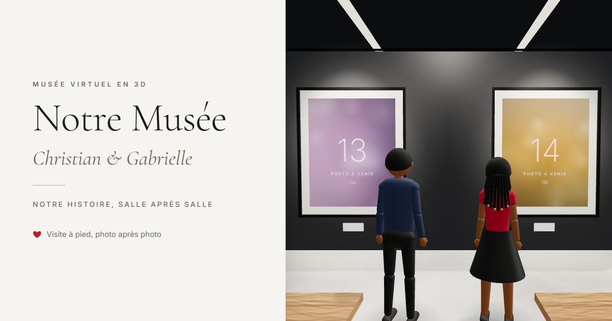

- Les balises sont générées **au build** depuis `config.json` (titre, prénoms, sous-titre).
- Les réseaux sociaux exigent une adresse d'image **absolue** : renseignez `urlSite` dans `config.json` avec l'adresse définitive du site. Sans ce champ, l'adresse fournie par Vercel (`VERCEL_PROJECT_PRODUCTION_URL`) ou par Netlify (`URL`) est utilisée au moment du build. Sur GitHub Pages, indiquez le chemin complet, par exemple `https://utilisateur.github.io/depot`.
- L'image `public/og-image.jpg` est une vraie vue du musée. Régénérez-la quand vous changez le titre, les prénoms ou les grands portraits :

```bash
npm run build && npm run og && npm run build
```

- Les applications gardent l'aperçu en cache. Pour forcer une mise à jour : [Facebook Sharing Debugger](https://developers.facebook.com/tools/debug/) (« Scrape Again ») ; sur Telegram, envoyez le lien au robot @WebpageBot ; sur WhatsApp, le nouvel aperçu apparaît pour les nouveaux messages (ou en ajoutant `?v=2` au lien).

### Paramètres d'adresse

| Paramètre | Effet |
| --- | --- |
| `?format=9x16` | Mode vidéo vertical sans interface (section 5). |
| `?pause=2` | Durée de l'arrêt devant chaque photo pendant la visite. |
| `?qualite=basse` / `?qualite=haute` | Force le niveau de qualité (sinon détection automatique). |

## 8. Performances

Objectifs : 60 i/s sur un PC moyen, au moins 30 i/s sur un Android milieu de gamme.

- **Détection mobile** : moins de lumières, pas d'ombres dynamiques (ombre douce de contact sous les avatars), pas de vitre, textures 1024 px, pixelRatio de 1,5 au plus (2 sur ordinateur).
- **Résolution adaptative** : sous 28 i/s pendant 3 s, la résolution baisse par paliers ; elle remonte quand la marge revient.
- **Un spot par cadre**, de façon économe : chaque cadre a son luminaire et son halo lumineux dessiné sur le mur. Seuls les 10 cadres les plus proches (4 sur mobile) reçoivent un vrai `SpotLight`, réaffecté en fondu quand on se déplace. Le nombre de lumières reste constant, ce qui évite de recompiler les shaders. Le rendu correspond à « un spot par cadre », sans le coût de 30 lumières.
- **Peu d'appels de dessin** : murs, plinthes et rails fusionnés, baguettes des cadres fusionnées, passe-partout, vitres, halos et projecteurs instanciés, avatars fusionnés par os.
- **Textures progressives** : miniatures d'abord, puis pleine résolution pour la salle courante et ses voisines. Les salles éloignées libèrent la mémoire (`dispose()`).
- Shaders compilés pendant l'écran de chargement (pas d'à-coup à l'entrée).

Mesures (Chromium, 1440×900, 17 photos) : environ 230 appels de dessin et 93 000 triangles en qualité haute (ombres comprises), 160 en qualité basse ; 92 appels en vue mobile 390×844.

## 9. Tests

```bash
npm test
```

Tests unitaires (Vitest) de la logique : dates, validation de `config.json`, répartition chronologique, choix des portraits de la cloison, sources d'images selon l'appareil, plan du musée (aucun cadre coupé par une ouverture ou un angle, grands formats sur murs pleins, bancs), collisions, rayon de caméra et recherche de chemin A*.

```bash
npm run build
```

```bash
npm run captures
```

Captures d'écran automatiques (Playwright) en 1440×900 et 390×844, avec relevé des erreurs console et des requêtes en échec. Scénarios : `defaut`, `marche`, `salles`, `photo`, `clic`, `assis`, `danse`, `visite`, `visite-complete`, `vertical`, `aide`, `erreur`, `perf`, par exemple `npm run captures -- photo danse`. Les images sont écrites dans `captures/`. Si le Chromium attendu par Playwright n'est pas installé, le script réutilise un Chromium déjà présent (ou celui indiqué par la variable `CHROMIUM_PATH`).

## 10. Organisation du code

```
config.json                 tout le contenu personnalisable
public/photos/<salle>/      vos photos et vidéos, un dossier par salle (+ optimisees/ générées par npm run photos)
public/assets/models/       avatars .glb facultatifs
public/assets/music/        musique de fond facultative
scripts/optimize-photos.mjs npm run photos (sharp)
scripts/lib/manifest.mjs    liste des fichiers présents (dimensions, EXIF, variantes)
scripts/captures.mjs        captures Playwright
scripts/fbx-to-glb.py       conversion Mixamo → GLB (Blender)
src/main.ts                 point d'entrée (chargement, accueil, mode 9:16)
src/App.ts                  orchestrateur : modes, boucle de rendu, actions
src/config/                 types, validation et normalisation de config.json
src/scene/                  rendu, lumières, plan procédural, murs, mobilier, collisions, A*, spots
src/gallery/                cadres, cartels, images de remplacement, textures progressives
src/avatars/                avatar procédural, animations, chargeur GLB, compagnon, navigation, couple
src/controls/               clavier, souris/tactile, joystick
src/camera/                 3e personne, directeur de caméra (GSAP), cadrage photo, visite guidée
src/ui/                     écrans, HUD, panneau photo, aide, messages, styles
src/audio/                  musique (fichier ou ambiance générée)
tests/                      tests unitaires (Vitest)
```

L'architecture est modulaire et entièrement pilotée par `config.json`. Pour générer plus tard un musée par client à partir de la même base, il suffit de produire un `config.json` et un dossier de photos par client (le plan s'adapte tout seul).

## 11. Dépannage

| Problème | Solution |
| --- | --- |
| Page « La configuration contient des erreurs » | Lisez la liste : chaque ligne indique le champ et un exemple. Erreurs JSON fréquentes : virgule en trop après le dernier élément, guillemets typographiques “ ” au lieu de " ". |
| Une photo affiche « Photo à venir » | Le fichier n'existe pas à l'emplacement indiqué (attention aux majuscules : `01.JPG` ≠ `01.jpg`), ou le site n'a pas été reconstruit après l'ajout. |
| Photo couchée | Lancez `npm run photos` (correction EXIF). |
| Pas de son | Le son démarre au clic sur « Entrer dans le musée ». Vérifiez la touche M et le volume de l'appareil. Si le fichier est illisible, l'ambiance générée prend le relais. |
| Page blanche en ouvrant `dist/index.html` par double-clic | Le site doit être servi par un serveur : `npm run preview`, ou déployez-le. |
| Lent sur un vieux téléphone | Ajoutez `?qualite=basse` ; réduisez le nombre de photos par salle. |

## 12. Améliorations possibles

- Enregistrement vidéo intégré (MediaRecorder sur le canvas) pour exporter directement un MP4/WebM 9:16.
- Narration : texte ou voix par photo pendant la visite guidée, sous-titres.
- Avatars : se tenir la main en marchant, slow dance enlacée, expressions du visage, plus de tenues et d'accessoires.
- Vidéos dans les cadres (VideoTexture) et sons d'ambiance par salle.
- Éclairage précalculé (lightmaps Blender) pour un rendu encore plus doux et moins coûteux.
- Textures compressées KTX2/Basis et modèles Draco/Meshopt pour charger plus vite sur mobile.
- Cartels regroupés dans un atlas (encore moins d'appels de dessin avec beaucoup de photos).
- Plans de musée en grille ou en étoile, plusieurs cloisons, mini-carte.
- Livre d'or des visiteurs, mode hors ligne (PWA), mode « mouvement réduit » (prefers-reduced-motion).
- Hors périmètre de cette version, mais l'architecture est prête : visite à plusieurs en temps réel, comptes clients, envoi de photos par les clients, paiement, back-office.

Crédits et licences : voir [CREDITS.md](CREDITS.md).
